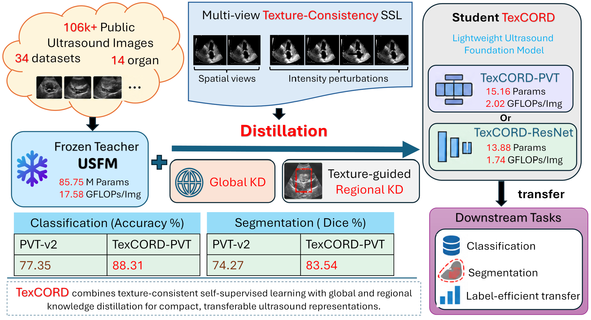

# TexCORD: Texture-Consistent Self-Supervised Learning and Regional Distillation for Lightweight Ultrasound Foundation Models

<p align="center">
  <b>Texture-aware self-supervised learning and ultrasound foundation-model distillation for compact, transferable ultrasound representations.</b>
</p>

<p align="center">
  
</p>

---

## Overview

**TexCORD** is a lightweight ultrasound representation-learning framework that combines:

- **Texture-consistency self-supervised learning (SSL)** to learn dense ultrasound-specific texture representations from unlabeled B-mode images.
- **Foreground-aware global knowledge distillation (KD)** to transfer image-level semantic information from a frozen ultrasound foundation model.
- **Texture-guided regional KD** to transfer teacher knowledge within soft regions defined by the student's learned texture assignments.
- **Lightweight student backbones**, including transformer- and CNN-based variants, for efficient downstream transfer.

TexCORD is designed to preserve local acoustic appearance while inheriting higher-level anatomical and semantic information from a large pretrained ultrasound teacher.

The framework is pretrained on approximately **106k public ultrasound images** aggregated from **34 datasets** spanning **14 anatomical groups**, and is evaluated on heterogeneous classification and segmentation benchmarks.

---

## Highlights

- **106k+** public ultrasound images for pretraining.
- **34 public datasets** spanning **14 anatomical groups**.
- Two lightweight student variants:
  - **TexCORD-PVT** — transformer-based student.
  - **TexCORD-ResNet** — convolutional student.
- Evaluated on **6 classification datasets** and **9 segmentation task-dataset pairs**.
- **88.31%** average classification accuracy with TexCORD-PVT.
- **83.54%** average segmentation Dice with TexCORD-PVT.
- Strong label efficiency: **80.44%** average classification accuracy using only **25%** of downstream labels, compared with **77.35%** for Scratch-PVT using 100% of the labels.
- Compact computational footprint relative to the large USFM teacher.

---

# TexCORD Pre-training Corpus

TexCORD is a multi-organ ultrasound imaging corpus assembled from 34 datasets covering 14 anatomical categories.

**Corpus summary:** 34 datasets · 106,469 reported images · 14 anatomical categories.

## Dataset Summary and Citations


| Dataset Name | Organ / Anatomical Region | No. of Images | Citation |
|:--|:--|--:|:--|
| AbdominalUS | Abdominal | 617 | [Vitale et al. (2020)](#ref-1) |
| C-TRUS | Abdominal | 827 | [Leenings et al. (2024)](#ref-2) |
| GDPH & SYSUCC | Breast | 2,405 | [Mo et al. (2023)](#ref-3) |
| BrEaST-Lesions_USG | Breast | 256 | [Pawłowska et al. (2024)](#ref-4) |
| BUS-UCLM | Breast | 683 | [Vallez et al. (2025)](#ref-5) |
| BUSBRA | Breast | 1,875 | [Gómez-Flores et al. (2024)](#ref-6) |
| BUS_UC | Breast | 811 | [Iqbal & Sharif (2024)](#ref-7) |
| KidenyUS | Kidney | 534 | [Singla et al. (2023)](#ref-8) |
| US-Liver | Liver | 635 | [Lu et al. (2025)](#ref-9) |
| 105US | Liver | 105 | [Hann et al. (2017)](#ref-10) |
| CAMUS | Cardiac | 21,232 | [Leclerc et al. (2019)](#ref-11) |
| CardiacUDC | Cardiac | 760 | [Yang et al. (2023)](#ref-12) |
| TED | Cardiac | 4,531 | [Painchaud et al. (2022)](#ref-13) |
| EchoCP | Cardiac | 11,519 | [Xu et al. (2020)](#ref-14) |
| FASS | Fetal Abdominal | 1,588 | [Da et al. (2023)](#ref-15) |
| Fast-U-Net | Fetal Abdominal | 1,414 | [Ashkani Chenarlogh et al. (2022)](#ref-16) |
| ACOUSLIC | Fetal Abdominal | 300 | [Gleed et al. (2023)](#ref-17) |
| HC | Fetal Head | 1,334 | [van den Heuvel et al. (2018)](#ref-18) |
| DFHI | Fetal Head | 3,832 | [Alzubaidi et al. (2023)](#ref-19) |
| JNU-IFM | Fetal Head | 6,224 | [Lu et al. (2022)](#ref-20) |
| Covid19 Ultrasound | Lung | 2,264 | [Born et al. (2021)](#ref-21) |
| COVID-BLUES | Lung | 4,133 | [Wiedemann et al. (2025)](#ref-22) |
| Lung Ultrasound | Lung | 1,062 | [Katumba et al. (2025)](#ref-23) |
| FALLMUD | Musculoskeletal | 504 | [Michard et al. (2021)](#ref-24) |
| deepMTJ | Musculoskeletal | 1,344 | [Leitner et al. (2021)](#ref-25) |
| Common Carotid Artery | Neck | 1,100 | [Momot (2022)](#ref-26) |
| brachial plexus | Neck | 7,462 | [Tyagi et al. (2024)](#ref-27) |
| UPBD | Neck | 955 | [Ding et al. (2022)](#ref-28) |
| Thyroid Dataset | Thyroid | 3,201 | [Gong et al. (2023)](#ref-29) |
| TN5000 | Thyroid | 5,000 | [Zhang et al. (2025)](#ref-30) |
| PCOSGen | Ovary | 4,668 | [Handa et al. (2023)](#ref-31) |
| POUI | Ovary | 54 | [Adiwijaya et al. (2021)](#ref-32) |
| MicroSeg | Prostate | 2,910 | [Jiang et al. (2024)](#ref-33) |
| JoCoHS | Knee | 10,330 | [Yerich et al. (2020)](#ref-34) |
| **Total (34 datasets)** | **14 anatomical categories** | **106,469** | |

## Corpus Composition by Anatomical Region

| Organ / Anatomical Region | Datasets | Images |
|:--|--:|--:|
| Abdominal | 2 | 1,444 |
| Breast | 5 | 6,030 |
| Kidney | 1 | 534 |
| Liver | 2 | 740 |
| Cardiac | 4 | 38,042 |
| Fetal Abdominal | 3 | 3,302 |
| Fetal Head | 3 | 11,390 |
| Lung | 3 | 7,459 |
| Musculoskeletal | 2 | 1,848 |
| Neck | 3 | 9,517 |
| Thyroid | 2 | 8,201 |
| Ovary | 2 | 4,722 |
| Prostate | 1 | 2,910 |
| Knee | 1 | 10,330 |
| **Total** | **34** | **106,469** |


## Checkpoints

| Model | Pretraining | Checkpoint |
|---|---|---|
| TexCORD-PVT | 106k+ public ultrasound images | Coming soon |
| TexCORD-ResNet | 106k+ public ultrasound images | Coming soon |

---

## Citation

If you use TexCORD in your research, please cite the paper.

```bibtex
@article{texcord,
  title   = {TexCORD: Texture-Consistent Self-Supervised Learning and Regional Distillation for Lightweight Ultrasound Foundation Models},
  author  = {TODO},
  journal = {TODO},
  year    = {TODO}
}
```

---


## Acknowledgments

TexCORD builds on publicly available ultrasound datasets and a pretrained ultrasound foundation-model teacher. Please cite the corresponding dataset and model publications when using these resources.

---

## References

<a id="ref-1"></a>
**[1] AbdominalUS:** **Vitale, S., Orlando, J. I., Iarussi, E., & Larrabide, I. (2020).** Improving realism in patient-specific abdominal ultrasound simulation using CycleGANs. *International journal of computer assisted radiology and surgery*, 15(2), 183–192.  
BibTeX key: `sm3_abdomenUS_vitale2020improving`

<a id="ref-2"></a>
**[2] C-TRUS:** **Leenings, R., Konowski, M., Winter, N. R., Ernsting, J., Fisch, L., et al. (2024).** C-TRUS: A Novel Dataset and Initial Benchmark for Colon Wall Segmentation in Transabdominal Ultrasound. *Simplifying Medical Ultrasound: 5th International Workshop, ASMUS 2024, Held in Conjunction with MICCAI 2024, Marrakesh, Morocco, October 6, 2024, Proceedings*, 101–111. [DOI](https://doi.org/10.1007/978-3-031-73647-6_10).  
BibTeX key: `10.1007/978-3-031-73647-6_10`

<a id="ref-3"></a>
**[3] GDPH & SYSUCC:** **Mo, Y., Han, C., Liu, Y., Liu, M., Shi, Z., et al. (2023).** Hover-trans: Anatomy-aware hover-transformer for roi-free breast cancer diagnosis in ultrasound images. *IEEE Transactions on Medical Imaging*, 42(6), 1696–1706.  
BibTeX key: `mo2023hover`

<a id="ref-4"></a>
**[4] BrEaST-Lesions_USG:** **Pawłowska, A., Ćwierz-Pieńkowska, A., Domalik, A., Jaguś, D., Kasprzak, P., et al. (2024).** Curated benchmark dataset for ultrasound based breast lesion analysis. *Scientific Data*, 11(1), 148.  
BibTeX key: `sm8_breast_pawlowska2024curated`

<a id="ref-5"></a>
**[5] BUS-UCLM:** **Vallez, N., Bueno, G., Deniz, O., Rienda, M. A., & Pastor, C. (2025).** BUS-UCLM: Breast ultrasound lesion segmentation dataset. *Scientific Data*, 12(1), 242.  
BibTeX key: `sm11_bus_uclm_vallez2025bus`

<a id="ref-6"></a>
**[6] BUSBRA:** **Gómez-Flores, W., et al. (2024).** BUS-BRA: a breast ultrasound dataset for assessing computer-aided diagnosis systems. *Medical Physics*, 51(4), 3110–3123.  
BibTeX key: `58gomez2024bus`

<a id="ref-7"></a>
**[7] BUS_UC:** **Iqbal, A. & Sharif, M. (2024).** Memory-efficient transformer network with feature fusion for breast tumor segmentation and classification task. *Engineering Applications of Artificial Intelligence*, 127, 107292.  
BibTeX key: `sm10_bus_us_iqbal2024memory`

<a id="ref-8"></a>
**[8] KidenyUS:** **Singla, R., Ringstrom, C., Hu, G., Lessoway, V., Reid, J., et al. (2023).** The open kidney ultrasound data set. *International Workshop on Advances in Simplifying Medical Ultrasound*, 155–164.  
BibTeX key: `sm22_kineyus_singla2023open`

<a id="ref-9"></a>
**[9] US-Liver:** **Lu, R. F., She, C. Y., He, D. N., Cheng, M. Q., Wang, Y., et al. (2025).** AI enhanced diagnostic accuracy and workload reduction in hepatocellular carcinoma screening. *NPJ Digital Medicine*, 8(1), 500.  
BibTeX key: `lu2025ai`

<a id="ref-10"></a>
**[10] 105US:** **Hann, A., Bettac, L., Haenle, M. M., Graeter, T., Berger, A. W., et al. (2017).** Algorithm guided outlining of 105 pancreatic cancer liver metastases in Ultrasound. *Scientific Reports*, 7(1), 12779.  
BibTeX key: `sm2_105_hann2017algorithm`

<a id="ref-11"></a>
**[11] CAMUS:** **Leclerc, S., Smistad, E., Pedrosa, J., Østvik, A., Cervenansky, F., et al. (2019).** Deep learning for segmentation using an open large-scale dataset in 2D echocardiography. *IEEE transactions on medical imaging*, 38(9), 2198–2210.  
BibTeX key: `sm13_camus_leclerc2019deep`

<a id="ref-12"></a>
**[12] CardiacUDC:** **Yang, J., Ding, X., Zheng, Z., Xu, X., & Li, X. (2023).** Graphecho: Graph-driven unsupervised domain adaptation for echocardiogram video segmentation. *Proceedings of the IEEE/CVF international conference on computer vision*, 11878–11887.  
BibTeX key: `yang2023graphecho`

<a id="ref-13"></a>
**[13] TED:** **Painchaud, N., Duchateau, N., Bernard, O., & Jodoin, P. M. (2022).** Echocardiography segmentation with enforced temporal consistency. *IEEE transactions on medical imaging*, 41(10), 2867–2878.  
BibTeX key: `painchaud2022echocardiography`

<a id="ref-14"></a>
**[14] EchoCP:** **Xu, X., Wang, T., Zhuang, J., Yuan, H., Huang, M., et al. (2020).** Imagechd: A 3d computed tomography image dataset for classification of congenital heart disease. *International conference on medical image computing and computer-assisted intervention*, 77–87.  
BibTeX key: `xu2020imagechd`

<a id="ref-15"></a>
**[15] FASS:** **Da, C., et al. (2023).** Fetal abdominal structures segmentation dataset using ultrasonic images. *Mendeley Data*.  
BibTeX key: `sm19_fass_da2023fetal`

<a id="ref-16"></a>
**[16] Fast-U-Net:** **Ashkani Chenarlogh, V., Ghelich Oghli, M., Shabanzadeh, A., Sirjani, N., Akhavan, A., et al. (2022).** Fast and accurate U-net model for fetal ultrasound image segmentation. *Ultrasonic imaging*, 44(1), 25–38.  
BibTeX key: `sm20_fast_unet_ashkani2022fast`

<a id="ref-17"></a>
**[17] ACOUSLIC:** **Gleed, A. D., Mishra, D., Chandramohan, V., Fu, Z., Self, A., et al. (2023).** Towards multi-sweep ultrasound video understanding: application in detection of breech position using statistical priors. *2023 IEEE 20th International Symposium on Biomedical Imaging (ISBI)*, 1–5.  
BibTeX key: `sm4_acouslic_gleed2023towards`

<a id="ref-18"></a>
**[18] HC:** **van den Heuvel, T. L., de Bruijn, D., de Korte, C. L., & Ginneken, B. V. (2018).** Automated measurement of fetal head circumference using 2D ultrasound images. *PloS one*, 13(8), e0200412.  
BibTeX key: `sm21_hc_van2018automated`

<a id="ref-19"></a>
**[19] DFHI:** **Alzubaidi, M., Agus, M., Makhlouf, M., Anver, F., Alyafei, K., et al. (2023).** Large-scale annotation dataset for fetal head biometry in ultrasound images. *Data in Brief*, 51, 109708. [DOI](https://doi.org/10.1016/j.dib.2023.109708).  
BibTeX key: `ALZUBAIDI2023109708`

<a id="ref-20"></a>
**[20] JNU-IFM:** **Lu, Y., Zhou, M., Zhi, D., Zhou, M., Jiang, X., et al. (2022).** The JNU-IFM dataset for segmenting pubic symphysis-fetal head. *Data in Brief*, 41, 107904. [DOI](https://doi.org/10.1016/j.dib.2022.107904).  
BibTeX key: `LU2022107904`

<a id="ref-21"></a>
**[21] Covid19 Ultrasound:** **Born, J., Wiedemann, N., Cossio, M., Buhre, C., Brändle, G., et al. (2021).** Accelerating detection of lung pathologies with explainable ultrasound image analysis. *Applied Sciences*, 11(2), 672.  
BibTeX key: `born2021accelerating`

<a id="ref-22"></a>
**[22] COVID-BLUES:** **Wiedemann, N., Boer, D. D. K. D., Richter, M., van de Weijer, S., Buhre, C., et al. (2025).** COVID-BLUeS - a Prospective Study on the Value of AI in Lung Ultrasound Analysis. *IEEE Journal of Biomedical and Health Informatics*, 29(9), 6301-6310. [DOI](https://doi.org/10.1109/JBHI.2025.3543686).  
BibTeX key: `10903196`

<a id="ref-23"></a>
**[23] Lung Ultrasound:** **Katumba, A., Murindanyi, S., Okila, N., Nakatumba-Nabende, J., Mwikirize, C., et al. (2025).** A dataset of lung ultrasound images for automated AI-based lung disease classification. *Data in Brief*, 62, 112034. [DOI](https://doi.org/10.1016/j.dib.2025.112034).  
BibTeX key: `KATUMBA2025112034`

<a id="ref-24"></a>
**[24] FALLMUD:** **Michard, H., Luvison, B., Pham, Q. C., Morales-Artacho, A. J., & Guilhem, G. (2021).** AW-Net: Automatic muscle structure analysis on B-mode ultrasound images for injury prevention. *Proceedings of the 12th ACM International Conference on Bioinformatics, Computational Biology, and Health Informatics*, 1–9.  
BibTeX key: `sm18_fallmud_michard2021aw`

<a id="ref-25"></a>
**[25] deepMTJ:** **Leitner, C., Jarolim, R., Englmair, B., Kruse, A., Hernandez, K. A. L., et al. (2021).** A human-centered machine-learning approach for muscle-tendon junction tracking in ultrasound images. *IEEE Transactions on Biomedical Engineering*, 69(6), 1920–1930.  
BibTeX key: `leitner2021human`

<a id="ref-26"></a>
**[26] Common Carotid Artery:** **Momot, A. (2022).** Common Carotid Artery Ultrasound Images. *Mendeley Data*. [DOI](https://doi.org/10.17632/d4xt63mgjm.1).  
BibTeX key: `momot_2022_common_carotid_artery_ultrasound_images`

<a id="ref-27"></a>
**[27] brachial plexus:** **Tyagi, A., Tyagi, A., Kaur, M., Aggarwal, R., Soni, K. D., et al. (2024).** Nerve block target localization and needle guidance for autonomous robotic ultrasound guided regional anesthesia. *2024 IEEE/RSJ International Conference on Intelligent Robots and Systems (IROS)*, 5867–5872.  
BibTeX key: `sm7_brachial_plexus_tyagi2024nerve`

<a id="ref-28"></a>
**[28] UPBD:** **Ding, Y., et al. (2022).** MallesNet: A multi-object assistance based network for brachial plexus segmentation in ultrasound images. *Medical Image Analysis*, 80, 102511.  
BibTeX key: `sm31_ubpd_ding2022mallesnet`

<a id="ref-29"></a>
**[29] Thyroid Dataset:** **Gong, H., Chen, J., et al. (2023).** Thyroid region prior guided attention for ultrasound segmentation of thyroid nodules. *Computers in biology and medicine*, 155, 106389.  
BibTeX key: `57gong2023thyroid`

<a id="ref-30"></a>
**[30] TN5000:** **Zhang, H., Liu, Q., Han, X., Niu, L., & Sun, W. (2025).** TN5000: An Ultrasound Image Dataset for Thyroid Nodule Detection and Classification. *Scientific Data*, 12(1). [DOI](https://doi.org/10.1038/s41597-025-05757-4).  
BibTeX key: `Zhang_2025`

<a id="ref-31"></a>
**[31] PCOSGen:** **Handa, P., Saini, A., Dutta, S., Pathak, H., Choudhary, N., et al. (2023).** PCOSGen-train dataset. *Zenodo*. [DOI](https://doi.org/10.5281/zenodo.10430727).  
BibTeX key: `handa_2023_10430727`

<a id="ref-32"></a>
**[32] POUI:** **Adiwijaya, Novia Wisesty, U., & Astuti, W. (2021).** Polycystic Ovary Ultrasound Images Dataset. *Telkom University Dataverse*. [DOI](https://doi.org/10.34820/FK2/QVCP6V).  
BibTeX key: `QVCP6V_2021`

<a id="ref-33"></a>
**[33] MicroSeg:** **Jiang, H., Imran, M., Muralidharan, P., Patel, A., Pensa, J., et al. (2024).** MicroSegNet: A deep learning approach for prostate segmentation on micro-ultrasound images. *Computerized Medical Imaging and Graphics*, 112, 102326.  
BibTeX key: `sm24_microseg_jiang2024microsegnet`

<a id="ref-34"></a>
**[34] JoCoHS:** **Yerich, N. V., Alvarez, C., Schwartz, T. A., Savage-Guin, S., Renner, J. B., et al. (2020).** A Standardized, Pragmatic Approach to Knee Ultrasound for Clinical Research in Osteoarthritis: The Johnston County Osteoarthritis Project. *ACR Open Rheumatology*, 2(7), 438-448. [DOI](https://doi.org/10.1002/acr2.11159).  
BibTeX key: `https://doi.org/10.1002/acr2.11159`

